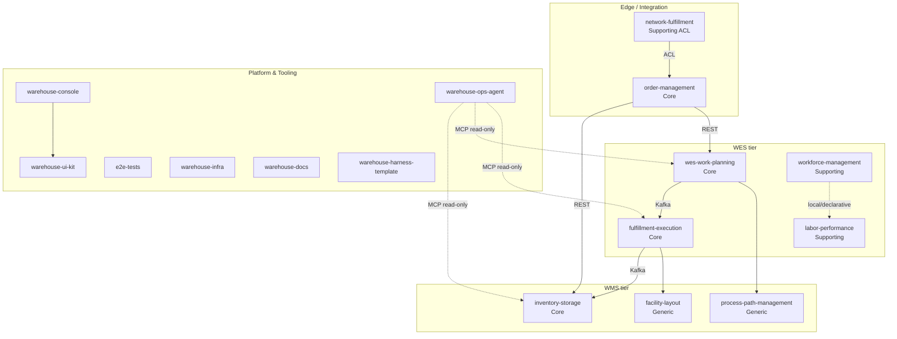

# IQVO

### Inventory · Queue · Value · Orchestration

**A Domain-Driven Design study: a full Warehouse Management / Execution System (WMS/WES) built as an independent, event-driven service fleet.**

---

## What this is

IQVO is a from-scratch warehouse platform built to practice strategic and tactical **Domain-Driven Design** end to end: context mapping, bounded-context carving, hexagonal architecture, event-driven integration, and fleet-wide governance — not a tutorial app, a real multi-service estate with CI, contracts, and operational tooling.

Every service is an independently deployable Go module behind its own REST API, communicating with its peers through **CloudEvents 1.0** over Kafka and through published REST contracts — never through a shared database.

## Context Map

## Bounded Contexts

| Context | Role | Stack | Repo |
|---|---|---|---|
| **Inventory & Storage** | Core — chaotic/random stow, revocable reservations, usable inventory | Go · Postgres · Kafka · REST | [`inventory-storage`](https://github.com/IQVO/inventory-storage) |
| **WES Work Planning & Release** | Core — charge, waveless release, flow balancing | Go · Postgres · Kafka · REST | [`wes-work-planning`](https://github.com/IQVO/wes-work-planning) |
| **Fulfillment Execution** | Core — Pick/Pack/SLAM task lifecycle, pull-based dispatch | Go · Postgres · Kafka · REST | [`fulfillment-execution`](https://github.com/IQVO/fulfillment-execution) |
| **Order Management** | Core — order intake, allocation, promise dates, release | Go · Postgres · REST | [`order-management`](https://github.com/IQVO/order-management) |
| **Facility Layout** | Generic — physical structure & slotting (Site/Zone/Aisle/LocationSlot) | Go · Postgres · REST | [`facility-layout`](https://github.com/IQVO/facility-layout) |
| **Process Path Management** | Generic — operator-configurable process-path topology | Go · Postgres · REST | [`process-path-management`](https://github.com/IQVO/process-path-management) |
| **Workforce Management** | Supporting — shift planning & labor assignment | Go · Postgres · Kafka · REST | [`workforce-management`](https://github.com/IQVO/workforce-management) |
| **Labor Performance** | Supporting — engineered labor standards & scoring | Go · Postgres · REST | [`labor-performance`](https://github.com/IQVO/labor-performance) |
| **Network Fulfillment** | Supporting / ACL — bridge to an external retail fulfillment network | Go · Postgres · REST | [`network-fulfillment`](https://github.com/IQVO/network-fulfillment) |

## Platform & Tooling

| Repo | Purpose |
|---|---|
| [`warehouse-console`](https://github.com/IQVO/warehouse-console) | React SPA shell — Module Federation host for the operator console |
| [`warehouse-ui-kit`](https://github.com/IQVO/warehouse-ui-kit) | Shared design tokens & component library for every micro-frontend |
| [`warehouse-ops-agent`](https://github.com/IQVO/warehouse-ops-agent) | Read-side decision-support agent, talks to the fleet via MCP |
| [`e2e-tests`](https://github.com/IQVO/e2e-tests) | Black-box godog harness driving every context over its public surface |
| [`warehouse-infra`](https://github.com/IQVO/warehouse-infra) | Terraform (kind cluster), Helm values, cross-service governance docs |
| [`warehouse-docs`](https://github.com/IQVO/warehouse-docs) | Fleet-wide DDD artifacts: context maps, ADRs, API references |
| [`warehouse-harness-template`](https://github.com/IQVO/warehouse-harness-template) | Canonical Go-service scaffold: Makefile, CI, lefthook, fitness tests |

## Principles

- **Hexagonal architecture** everywhere — domain core isolated from Postgres, Kafka, and REST adapters.
- **CloudEvents 1.0** mandatory on every Kafka message — no flat/dual envelope modes.
- **GitFlow** with branch protection — `feature/*` → PR into `develop`; `main` is release-only, CI-gated.
- **No shared databases** — every cross-context read goes through a published REST/MCP contract or an event.
- Some contexts (e.g. `process-path-management`, `labor-performance`) deliberately forbid *any* live call to siblings — cross-context data there is local and declarative only.

---

Built and maintained by <a href="https://github.com/claudioed">@claudioed</a> as a Domain-Driven Design study project.

