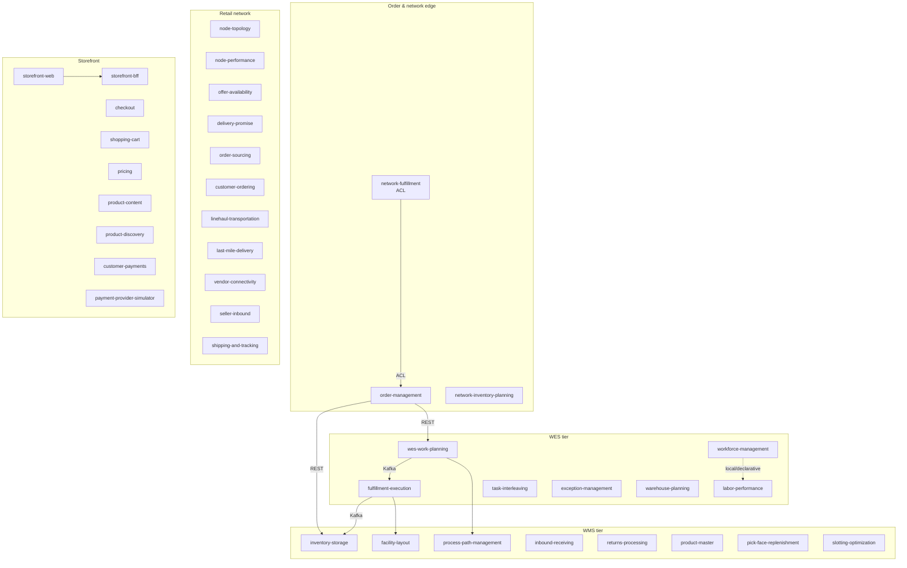

# IQVO

### Inventory · Queue · Value · Orchestration

**A Domain-Driven Design study: a warehouse (WMS/WES), a retail fulfillment network and an e-commerce storefront, built as 38 independent, event-driven bounded contexts.**

---

## What this is

IQVO is a from-scratch platform built to practice strategic and tactical **Domain-Driven Design** end to end: context mapping, bounded-context carving, hexagonal architecture, event-driven integration, and fleet-wide governance. It is not a tutorial app but a real multi-service estate with CI, contracts and operational tooling, and it has grown from one warehouse into three connected domains:

- **Warehouse** — the WMS tier (what is stored where) and the WES tier (what work happens now).
- **Retail network** — a fulfillment network of nodes, lanes and service areas that sources orders, makes delivery promises and tracks shipments.
- **Storefront** — the e-commerce side: catalogue, cart, checkout and payment, behind a single BFF.

Every service is an independently deployable Go module behind its own REST API, communicating with its peers through **CloudEvents 1.0** over Kafka and through published REST contracts — never through a shared database. Most services also publish a read-only **MCP** server and an **A2A** endpoint, so agents can use the estate the way people use the console.

## Context Map

The diagram shows the relationships that are documented across contexts; the remaining integrations (Kafka topics and published REST contracts) are in the [EventCatalog](https://github.com/IQVO/ecosystem) and in [`warehouse-docs`](https://github.com/IQVO/warehouse-docs). Retail-network and storefront contexts follow the same rule as the warehouse ones: no live lookups into a sibling where a local, event-fed copy will do.

## Bounded Contexts

### WMS tier — what is stored where

| Context | Role | Repo |
|---|---|---|
| **Inventory & Storage** | Core — chaotic/random stow, revocable reservations, usable inventory | [`inventory-storage`](https://github.com/IQVO/inventory-storage) |
| **Facility Layout** | Generic — physical structure and slotting (Site/Zone/Aisle/LocationSlot) | [`facility-layout`](https://github.com/IQVO/facility-layout) |
| **Process Path Management** | Generic — operator-configurable process-path topology | [`process-path-management`](https://github.com/IQVO/process-path-management) |
| **Inbound Receiving** | Supporting — advance ship notices, dock appointments, goods receipt with discrepancy capture | [`inbound-receiving`](https://github.com/IQVO/inbound-receiving) |
| **Returns Processing** | RMA, return receipt, grading and disposition; hands restockable goods to inventory | [`returns-processing`](https://github.com/IQVO/returns-processing) |
| **Product Master** | Supporting — SKU master data, declared vs measured dimensions and weight | [`product-master`](https://github.com/IQVO/product-master) |
| **Pick-Face Replenishment** | Supporting — min/max requests moving stock from reserve to forward slots | [`pick-face-replenishment`](https://github.com/IQVO/pick-face-replenishment) |
| **Slotting Optimization** | Supporting — velocity-driven slot plans and moves from event-fed local copies | [`slotting-optimization`](https://github.com/IQVO/slotting-optimization) |

Also in this tier, built but not yet part of the deployed fleet: [`dock-scheduling`](https://github.com/IQVO/dock-scheduling), [`outbound-shipping`](https://github.com/IQVO/outbound-shipping), [`yard-management`](https://github.com/IQVO/yard-management).

### WES tier — what work happens now

| Context | Role | Repo |
|---|---|---|
| **WES Work Planning & Release** | Core — charge, waveless release, flow balancing | [`wes-work-planning`](https://github.com/IQVO/wes-work-planning) |
| **Fulfillment Execution** | Core — Pick/Pack/SLAM task lifecycle, pull-based dispatch with leases | [`fulfillment-execution`](https://github.com/IQVO/fulfillment-execution) |
| **Workforce Management** | Supporting — shift planning and labor assignment | [`workforce-management`](https://github.com/IQVO/workforce-management) |
| **Labor Performance** | Supporting — engineered labor standards and actual-vs-standard scoring | [`labor-performance`](https://github.com/IQVO/labor-performance) |
| **Task Interleaving** | Supporting — advisory next-task hints that chain compatible tasks by travel distance | [`task-interleaving`](https://github.com/IQVO/task-interleaving) |
| **Exception Management** | Problem-solve lifecycle for anomalies other contexts detect (open, triage, assign, resolve, SLA) | [`exception-management`](https://github.com/IQVO/exception-management) |
| **Warehouse Planning** | Core — process-path capacity and forward-looking shortage detection | [`warehouse-planning`](https://github.com/IQVO/warehouse-planning) |

### Order and network edge

| Context | Role | Repo |
|---|---|---|
| **Order Management** | Core — order intake, allocation, promise dates, release | [`order-management`](https://github.com/IQVO/order-management) |
| **Network Fulfillment** | Supporting / ACL — anti-corruption layer to an external retail fulfillment network | [`network-fulfillment`](https://github.com/IQVO/network-fulfillment) |
| **Network Inventory Planning** | SKU placement, inventory balancing and inter-warehouse transfer orchestration | [`network-inventory-planning`](https://github.com/IQVO/network-inventory-planning) |

### Retail network — nodes, promises, shipments

| Context | Role | Repo |
|---|---|---|
| **Node Topology** | Supporting — the authoritative registry of nodes, operational profiles, lanes, regions and postal service areas (Open Host Service) | [`node-topology`](https://github.com/IQVO/node-topology) |
| **Node Performance** | Supporting — measures every node against what it declared and grades it (scorecards) | [`node-performance`](https://github.com/IQVO/node-performance) |
| **Offer & Availability** | Supporting — what the network can sell and from which node | [`offer-availability`](https://github.com/IQVO/offer-availability) |
| **Delivery Promise** | Core — quotes a delivery date only from a feasible path with capacity, and holds that capacity | [`delivery-promise`](https://github.com/IQVO/delivery-promise) |
| **Order Sourcing** | Core — decides, as late as the promise allows, which node and path fulfil each shipment group | [`order-sourcing`](https://github.com/IQVO/order-sourcing) |
| **Customer Ordering** | Generic — turns a cart into a customer order; status, tracking, cancellation | [`customer-ordering`](https://github.com/IQVO/customer-ordering) |
| **Linehaul Transportation** | Supporting — the middle mile: scheduled departures, capacity, loads | [`linehaul-transportation`](https://github.com/IQVO/linehaul-transportation) |
| **Last-Mile Delivery** | Supporting — delivery waves, routes for delivery partners, delivery attempts | [`last-mile-delivery`](https://github.com/IQVO/last-mile-delivery) |
| **Vendor Connectivity** | Supporting — the Vendor API for vendors that operate fulfillment nodes (Open Host Service) | [`vendor-connectivity`](https://github.com/IQVO/vendor-connectivity) |
| **Seller Inbound** | Supporting — the seller-facing front door for stock coming into the network (SSCC case packs) | [`seller-inbound`](https://github.com/IQVO/seller-inbound) |
| **Shipping & Tracking** | Generic — shipping labels and one customer-visible timeline per package | [`shipping-and-tracking`](https://github.com/IQVO/shipping-and-tracking) |

### Storefront — e-commerce

| Context | Role | Repo |
|---|---|---|
| **Storefront Web** | React 19 SSR pages; talks only to the BFF | [`storefront-web`](https://github.com/IQVO/storefront-web) |
| **Storefront BFF** | Generic — the only storefront edge; composes the storefront contexts, no database | [`storefront-bff`](https://github.com/IQVO/storefront-bff) |
| **Checkout** | Supporting — the purchase saga across price, payment and the network's promise | [`checkout`](https://github.com/IQVO/checkout) |
| **Shopping Cart** | Supporting — a shopper's intent: lines, delivery quote, tier selection, estimate | [`shopping-cart`](https://github.com/IQVO/shopping-cart) |
| **Pricing** | Core — what a shopper pays: prices, delivery charges, tax, binding price quotes | [`pricing`](https://github.com/IQVO/pricing) |
| **Product Content** | Generic — descriptions, attributes, media, the category tree | [`product-content`](https://github.com/IQVO/product-content) |
| **Product Discovery** | Supporting — the read side of browsing and search | [`product-discovery`](https://github.com/IQVO/product-discovery) |
| **Customer Payments** | Generic — authorize, capture per shipment, release, refund | [`customer-payments`](https://github.com/IQVO/customer-payments) |
| **Payment Provider Simulator** | A stand-in payment provider | [`payment-provider-simulator`](https://github.com/IQVO/payment-provider-simulator) |

## Platform & Tooling

| Repo | Purpose |
|---|---|
| [`warehouse-infra`](https://github.com/IQVO/warehouse-infra) | Terraform + Helm for the whole fleet: a local `kind` cluster or an existing `k3s` cluster, ArgoCD GitOps, Kong (APIs) and Nginx (UI) edges, Kafka, Postgres/PgBouncer, observability |
| [`warehouse-console`](https://github.com/IQVO/warehouse-console) | React SPA shell — Module Federation host for the operator console |
| [`warehouse-ui-kit`](https://github.com/IQVO/warehouse-ui-kit) | Shared design tokens and component library for every micro-frontend |
| [`warehouse-floor-client`](https://github.com/IQVO/warehouse-floor-client) | Scan-first PWA for RF guns and station screens |
| [`warehouse-ops-agent`](https://github.com/IQVO/warehouse-ops-agent) | Read-side decision-support agent, talks to the fleet via MCP |
| [`ecosystem`](https://github.com/IQVO/ecosystem) | EventCatalog: every bounded context, REST API and CloudEvent |
| [`warehouse-docs`](https://github.com/IQVO/warehouse-docs) | Fleet-wide DDD artifacts: context maps, ADRs, API references, the retail-network and storefront models |
| [`e2e-tests`](https://github.com/IQVO/e2e-tests) | Black-box godog harness driving the contexts over their public surface |
| [`warehouse-harness-template`](https://github.com/IQVO/warehouse-harness-template) | Canonical Go-service scaffold: Makefile, CI, lefthook, fitness tests |
| [`landing-page`](https://github.com/IQVO/landing-page) | The organisation's landing page |
| [`provisioning`](https://github.com/IQVO/provisioning) | Scripts that register facilities in facility-layout |

## How it runs

- **One registry, 41 applications.** [`warehouse-infra`](https://github.com/IQVO/warehouse-infra)'s `terraform/apps.yaml` is the single list of what is deployed. ArgoCD installs each chart from its own repo; Terraform owns only the platform contract (database, secrets, image tag).
- **Two edges that never chain.** Kong serves every API under `/api/<context>` (plus `/api/mcp/...` and `/api/a2a/...`); Nginx serves the console and the micro-frontends. Kong never serves assets.
- **Two environments.** A local `kind` cluster builds and side-loads its images; an existing `k3s` cluster is deployed without touching the machine, pulling arm64 images that a GitHub Actions workflow publishes to `ghcr.io/iqvo/warehouse-infra`.
- **Observable by default.** OpenTelemetry to Jaeger, Prometheus, Loki and Grafana, with dashboards and alert rules as code.

## Principles

- **Hexagonal architecture** everywhere — domain core isolated from Postgres, Kafka and REST adapters.
- **CloudEvents 1.0** mandatory on every Kafka message — no flat or dual envelope modes.
- **GitFlow** with branch protection — `feature/*` → PR into `develop`; `main` is release-only, CI-gated.
- **No shared databases** — every cross-context read goes through a published REST/MCP contract or an event.
- Some contexts (e.g. `process-path-management`, `labor-performance`) deliberately forbid *any* live call to siblings — cross-context data there is local and declarative only.

---

## Disclaimer

This project is a domain-driven design study. It is not associated with, endorsed by or affiliated with any company, and it uses no company's code, data, logos or trademarks. All names, figures and examples are illustrative or synthetic.

Built and maintained by <a href="https://github.com/claudioed">@claudioed</a> as a Domain-Driven Design study project.

